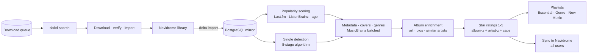

# 🎵 Popularr

*Music intelligence for Navidrome — scores, rates, curates and completes your library.*

**Self-hosted** · **Python / Quart** · **PostgreSQL** · **Docker**

[](https://www.python.org)
[](https://quart.palletsprojects.com)
[](https://www.postgresql.org)
[](https://www.docker.com)
[](https://www.navidrome.org)

</div>

Popularr is a self-hosted music management companion for **[Navidrome](https://www.navidrome.org)**.
It looks at your library the way a data analyst would: it **scores every track for popularity**,
turns those scores into **1–5★ ratings**, **detects singles and cover songs**, **builds playlists**
from what you actually love, **downloads what's missing** over Soulseek, and pushes the ratings
back into Navidrome so every app that reads your library — Plex, Jellyfin, DSub, Feishin — shows
the same stars.

It is *not* a media server, a tag editor, or a replacement for Navidrome. It is the intelligence
layer that sits beside it.

## ✨ Why Popularr?

| Problem | Popularr's answer |
| --- | --- |
| "I have 40,000 tracks and no idea what deserves 5★" | Objective, explainable popularity scores blended from Last.fm, ListenBrainz and release age — re-anchored per album and per artist |
| "My ratings are inconsistent" | One deterministic pipeline rates every album the same way, and syncs the result to every Navidrome user |
| "I never hear my own deep cuts" | Auto-generated **Essential**, **Genre Top-Tracks** and **New Music** playlists from your 4★/5★ tracks |
| "Which of these albums is the single?" | Multi-source singles detection (Discogs, MusicBrainz, Last.fm, ListenBrainz) with confidence levels that feed the ratings |
| "I keep finding covers mislabeled as originals" | A full CoverDetector pass (ISRC → MusicBrainz relations → writer analysis) renames confirmed covers to `Title (Artist Cover)` |
| "My library has gaps" | MusicBrainz search + Soulseek (slskd) downloads with a quality filter, a queue, retries and a watcher that imports completed files |
| "I don't trust automation with my files" | A master **tag-writing toggle** turns Popularr into a read-only database scanner — your audio files are never touched |

---

## 🚀 Key Features

### Scoring & ratings

Every track gets a **0–100 popularity score** and a **1–5★ rating**, both fully explainable:

- **Weighted blend** — Last.fm `0.55` / ListenBrainz `0.35` / release-age `0.10` by default, re-normalised over whichever signals are present. Live tracks take a Last.fm weight penalty (0.5×) and instrumental tracks 0.8×, and an internal **log-ratio audit** flags when the two scrobble sources disagree wildly.
- **Z-scores, not raw counts** — each score is a robust z-score (median + MAD) against the album's own distribution, then **re-anchored album-relative**, with the pre-remap raw blend persisted so re-rating can never erode 5★ over repeated scans.
- **Artist-catalogue context** — ratings also look at where a track falls in the *artist's* catalogue (top-X% force bands, mid-rank percentiles). Singles and EP releases with only 1–2 tracks are rated against the artist's catalogue, not their own pool; **compilations** are rated per credited track artist; **live albums** are rated against the artist catalogue (album-z only gates or promotes).
- **Star bands** (defaults) — 5★ needs album-z ≥ 1.0 *and* artist-z ≥ 1.2, 4★ ≥ 0.5, 3★ ≥ −0.5, 2★ ≥ −1.2; era-style **per-release slot caps** (1× 5★, 2× 4★) stop one album hoarding the top tier; a catalogue-top pre-lock is a *gate*, not a verdict. Tracks under the short-track cap (default 70 s) are capped at 2★, hearted favourites get a rating floor, and a confirmed single gets a small boost.
- Every score is logged with its weights, z-scores and evidence, and the final ratings are **synced back to Navidrome** (Subsonic `setRating`) for every configured user.

### Seven modular scan modes

`Full` · `Navidrome` · `Popularity` · `Metadata` · `Singles` · `Finalise` · `Essentia` — each
decoupled with its own **rescan window** (days, `0` = always run), so you can re-check singles
without re-scoring popularity, or run a background finalise pass that catches up file tags and
playlists. Forced scans bypass the windows; scans are incremental per album with `skip-unchanged`
short-circuits, per-album time budgets and resume checkpoints.

### Library intelligence

- **Single detection** — an 8-stage algorithm across Discogs, MusicBrainz, Last.fm, ListenBrainz and radio-edit heuristics, producing **high / medium / low** confidence that feeds the ratings (see below).
- **Cover-song detection** — an album-level pass (ISRC → MusicBrainz work relations → writer analysis) that renames confirmed covers to `Title (Artist Cover)` and tags them, with a work-MBID-first fast path.
- **Album-type classification** — a shared release-category registry (album / EP / single / live / soundtrack / DJ-mix / compilation…) keeps every surface — artist page, missing releases, filters — consistent with MusicBrainz types (composite types like `album+live` preserved).
- **Genre aggregation** across MusicBrainz / Discogs / AudioDB / Essentia / Last.fm / ListenBrainz with synonym and junk-genre normalisation, per-source columns, filter tags (live / cover / acoustic / christmas…) and VA-compilation per-track artist fallback.
- **MBID-first metadata** — identity is resolved to MusicBrainz IDs (recording / work / release / release-group) and reused everywhere; recorded identity is cached per album batch and per-track inference is gated on verified track-number + length matches, with unconfirmed changes routed to a **"metadata requiring approval"** panel instead of silently applied.
- **Corrections surfaces** — three complementary levels: artist list badges, per-artist corrections (duplicate tracks / artists, disc cleanup, missing MB tracks) and a global tag-conflicts page.
- Album art with a Navidrome-first precedence, similar-artist recommendations, live / remix / alternate-take tagging and artist metadata (bio, country, members) refreshed once per artist scan.

### Single detection (8 stages)

Popularity scans classify every track `single` / `not single` with a **high / medium / low**
confidence. The pipeline (`services/enrichment/single_detection_service.py`) is a staged algorithm:

1. **Pre-filter & validation** — skip intros/outros/jams, explicit live/remix/acoustic/demo/instrumental titles, and non-canonical versions.
2. **Z-score threshold gate** — a track's popularity z within its album and artist must clear a size- and age-aware threshold before it can count as a single.
3. **Discogs confirmation** — release formats and single/video tracks; a full-confidence Discogs match short-circuits the rest (it is the strongest single signal).
4. **MusicBrainz confirmation + compilation check** — release-group search and single/EP typing, with compilation albums treated distinctly.
5. **Radio-edit / single-marker detection** — title markers like `(radio edit)`, `(single version)`.
6. **Title normalisation & duration matching** — suffix stripping so `Title (radio edit)` matches its album counterpart.
7. **Last.fm album track-count check** — an album that lists far fewer tracks than its release exists as a single.
8. **Final hybrid confidence decision** — votes across sources (Discogs, MusicBrainz, Last.fm, ListenBrainz, radio-edit, video) with configurable per-source weights produce the final label and confidence, which then feed star rating.

The verdict is persisted per track and cached so subsequent scans don't re-run the whole fan-out every pass.

### Background schedules

APScheduler jobs run the recurring work — all editable from the Config page (interval `0` disables):

| Job | Default | Work |
| --- | --- | --- |
| `library_sync` | every 6 h | Navidrome delta sync + downloads-folder import |
| `popularity_scan` | daily | popularity recalculation + finalise; miss-retry window (Thursday slot) for downloads |
| `upcoming_wikipedia` | daily | upcoming-releases scrape |
| `upcoming_musicbrainz` | weekly | MusicBrainz global release discovery |
| `missing_releases` | daily | missing-release tracklist backfill |
| `download_queue_processor` | every 30 s | queue cycle: maintenance (completion, retry, cleanup) + next batch |

### Playlists

Three auto-generated families, all maintained **in place through Navidrome's Subsonic API** (no `.m3u` files on disk):

- **Essential Collection** — `{Artist} - Essential Collection`, the artist's 4★/5★ best-of (max 50 tracks by default, needs ≥ 12 to be created), de-duplicated on normalised title/artist keys and guest-credit aware.
- **Genre Top Tracks** — `{Genre} - Top Tracks` from every 4★+ track (max 300, max 25 per artist by default), ordered star-tier-first, with Christmas and filter-tag genres excluded from ordinary lists.
- **New Music** — a rolling recently-added list (100 tracks).

The writer **skips byte-identical playlists** (no rewrites on a quiet scan), coalesces global rebuilds, and logs which tracks were dropped for size. On top of this you get CSV playlist import (Exportify), add-to-playlist from any track, ZIP export, and weekly ListenBrainz sync.

### Downloads

A complete **Soulseek (slskd) → library** pipeline, driven by a persistent queue:

- **Search & rank** — fan-out queries ranked by relevance, then quality. A quality gate enforces min bitrate (192) / sample rate (44.1 kHz) over lossless-first containers (FLAC, WAV, AIFF, ALAC, APE, WV); **missing attributes count as unknown, not as failures**, and peers are ranked by free upload slot → shorter queue → faster speed.
- **Hard gates before download** — a candidate that fails the title / artist / year / album checks is rejected with a reason (`no_artist_evidence`, `year_mismatch`…) and the closest miss is logged once per track. A compilation-aware gate stops wrong-release rejects on VA tracks. Wrong files block the offending peer.
- **Smart retry** — empty searches abort early (~90 s), query waits shrink after consecutive misses, and a miss backoff ladder (4 h → 12 h → 24 h) eventually settles into **one weekly slot** so hopeless tracks stop burning your slskd budget. A disconnected slskd yields a distinct `slskd_disconnected` outcome — no false `no_results` backoff.
- **Completion & import** — completed files are verified against the requested track (name + duration), optionally converted FLAC→MP3/M4A, moved into the library using your naming convention, tagged from stored/MusicBrainz metadata (including inherited album MBIDs from sibling tracks), and the imported row is recorded. A watcher sweeps the downloads folder, and **Matched & Unmatched Folders** lets you associate a folder with a MusicBrainz release (two-phase: associate → confirm) before moving or deleting anything.

### Extras

- **Essentia** on-device mood & genre tagging (TensorFlow, no internet needed)
- **Upcoming releases** — daily Wikipedia scrape + weekly MusicBrainz global discovery, filterable and one-click to queue for download
- **Universal search** across your library, MusicBrainz and Soulseek in one flyout
- **Live log viewer** with SSE streaming, level filters and regex search
- **Multi-user Navidrome sync** (ratings, favourites/hearts with a rating floor), **read-only mode** (a single toggle keeps your audio files untouched), a Config page that writes `config.yaml`, a 6-step setup wizard, and in-app help
- **Sandbox page** for experimenting with the scoring parameters before they affect ratings

---

## 🧠 How It Works



A **Full scan** runs the passes in a deliberately decoupled order:

1. **Navidrome import** — delta-sync your library (and any new files) into the local PostgreSQL mirror
2. **Basic metadata** — album type + artist MusicBrainz IDs (inputs to singles detection)
3. **Popularity** — score every track from Last.fm / ListenBrainz / age, re-anchored album-relative
4. **Singles detection** — label each track high / medium / low confidence
5. **Per-track metadata + covers + genres** (MusicBrainz lookups batched per album)
6. **Full album enrichment** — art, artist bios, similar artists, live/remix tagging, alternate takes
7. **Star ratings + playlists** → persisted → synced to Navidrome (all users)

Every scan is incremental: albums processed within a mode's **rescan window** are skipped with a
single log line — no API calls, no re-scoring, no re-sync. Set a window to `0` and that scan always
runs in full; forced scans bypass the windows and rebuild the caches.

> 📘 **Want the details?** The in-app **[User Guide](documentation/USER_GUIDE.md)** explains the whole
> pipeline in plain language — how scores become stars, what every setting does, and how config
> changes affect your library.

---

## 🛠️ Quick Start

### Prerequisites

- [Docker](https://docs.docker.com/engine/install/) + Docker Compose
- A [Navidrome](https://www.navidrome.org) instance (v0.52+ recommended)
- Optional: an [slskd](https://github.com/slskd/slskd) instance for downloads

### Run it

```bash
git clone https://github.com/M0VENTURA/Popularr.git
cd Popularr
# point MUSIC_ROOT (and DOWNLOADS_DIR if you use downloads) at your folders
cp .env.example .env   # adjust paths / ports
docker compose up -d
```

Open `http://localhost:5000` — the 6-step setup wizard will connect you to Navidrome and
PostgreSQL, then run your first **Full** scan. That's it.

### Useful commands

```bash
docker compose up -d          # start
docker compose logs -f app    # follow the app log
docker compose down           # stop
docker compose build --no-cache && docker compose up -d   # rebuild
```

---

## ⚙️ Configuration

Everything is adjustable from the web UI (**Config** page), persisted to `config.yaml`:

- **System** — music users (Navidrome + per-user Last.fm/ListenBrainz), logging, schedulers, startup checks
- **Integrations** — API keys (Last.fm, Discogs, AudioDB), ListenBrainz needs no key
- **Downloads** — slskd connection, quality filter, search tuning (empty-abort, query waits, miss backoff and the weekly retry slot), watcher, retry/cleanup schedulers, conversion
- **Files** — naming convention, FLAC→MP3/M4A conversion, tag-writing (read-only mode), Essentia
- **Matching** — matching thresholds, search filters, Last.fm advanced, album-MBID guard
- **Scoring** — popularity weights, rescan windows, single detection, star bands (album-z / artist-z per tier), genre weights, album scaling, live-album and short-track rules
- **Playlists** — essential / genre / new-music switches, name templates, size caps and per-artist limits

See [documentation/Services/CONFIGURATION_GUIDE.md](documentation/Services/CONFIGURATION_GUIDE.md)
for the full reference.

---

## 📚 Documentation

| Doc | Purpose |
| --- | --- |
| [User Guide](documentation/USER_GUIDE.md) | How the app works, the scoring pipeline, and what settings do — start here |
| [Architecture](documentation/POPULARR_ARCHITECTURE.md) | System design and decision notes |
| [Configuration Guide](documentation/Services/CONFIGURATION_GUIDE.md) | Every configurable parameter |
| [Documentation Index](documentation/README.md) | All docs, change logs and technical notes |

The application also ships an in-app help section (**Help** in the navbar, `/help`) with the full
user guide and searchable documentation.

---

## 🧰 Tech Stack

- **Backend** — Python 3.11, [Quart](https://quart.palletsprojects.com) (async), SQLAlchemy 2.0
- **Database** — PostgreSQL 16 (the only persistence layer)
- **Frontend** — Server-rendered Jinja2 templates, Bootstrap 5.3 dark, vanilla JS (no build step required; esbuild optional), with a rebuilt UI available as `test_site/`
- **Integrations** — Navidrome/Subsonic API, Last.fm, ListenBrainz (no key), MusicBrainz + Cover Art Archive, Discogs, AudioDB, Wikidata, LRCLib, Essentia, and slskd/Soulseek
- **Infrastructure** — Docker Compose, APScheduler background jobs (library sync, popularity, upcoming releases, queue processor), SSE live log streaming

---

## 🧑‍💻 Development

```text
app.py                    minimal orchestration (blueprints + background services)
routes/                   Quart blueprints — UI pages and /api endpoints
services/                 application layer: scanning/ · popularity/ · enrichment/ ·
                          metadata/ · downloads/ · queue/ · playlists/ · upcoming_releases/
api_clients/              HTTP-only clients (Navidrome, Last.fm, MusicBrainz, Discogs,
                          ListenBrainz, AudioDB, Cover Art Archive, slskd…) — no business logic
db/                       repositories (the ONLY writers) · engine · schema · models
db/repositories/          PostgreSQL persistence
migrations/ + alembic.ini Alembic schema migrations
helpers/                  config, settings, logging, app bootstrap/hooks, task manager
templates/ · static/      the live Jinja UI and assets
test_site/                the rebuilt UI (served when features.use_test_site is on)
documentation/            architecture doc, user guide, config guide, change logs
tests/                    pytest suite (pytest.ini — asyncio_mode=auto, SQLite in-memory)
old_system/               frozen historical reference — never modify
```

**Layering (keep it intact when contributing):** `routes/` → `services/` → `api_clients/` →
`db/repositories/` → PostgreSQL. API clients only do HTTP (rate limits, retries, circuit
breakers); services hold the decisions; repositories are the only writers. New route modules are
registered in `helpers/app_bootstrap.py`, routes are auth-gated by default
(`helpers/app_hooks.py`), and every DB access goes through short-lived `with db_session() as`
transactions. Config values belong on the **Config page** → `config.yaml`, never hard-coded.

**Testing:** `pytest` with `DATABASE_URL=sqlite:///:memory:` (set by `tests/conftest.py`). Add a
test for every new behaviour; keep the existing suite green.

---

*Popularr — let your library tell you what it loves.*
